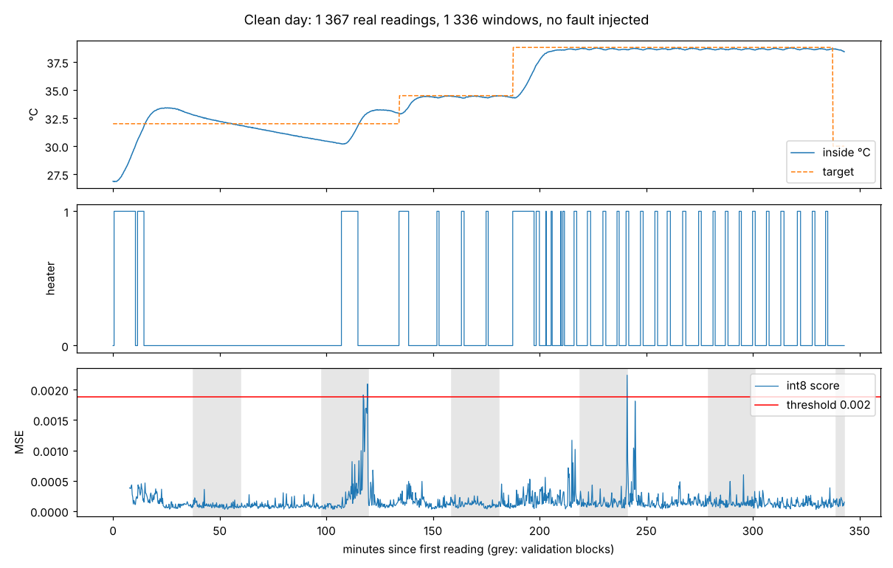
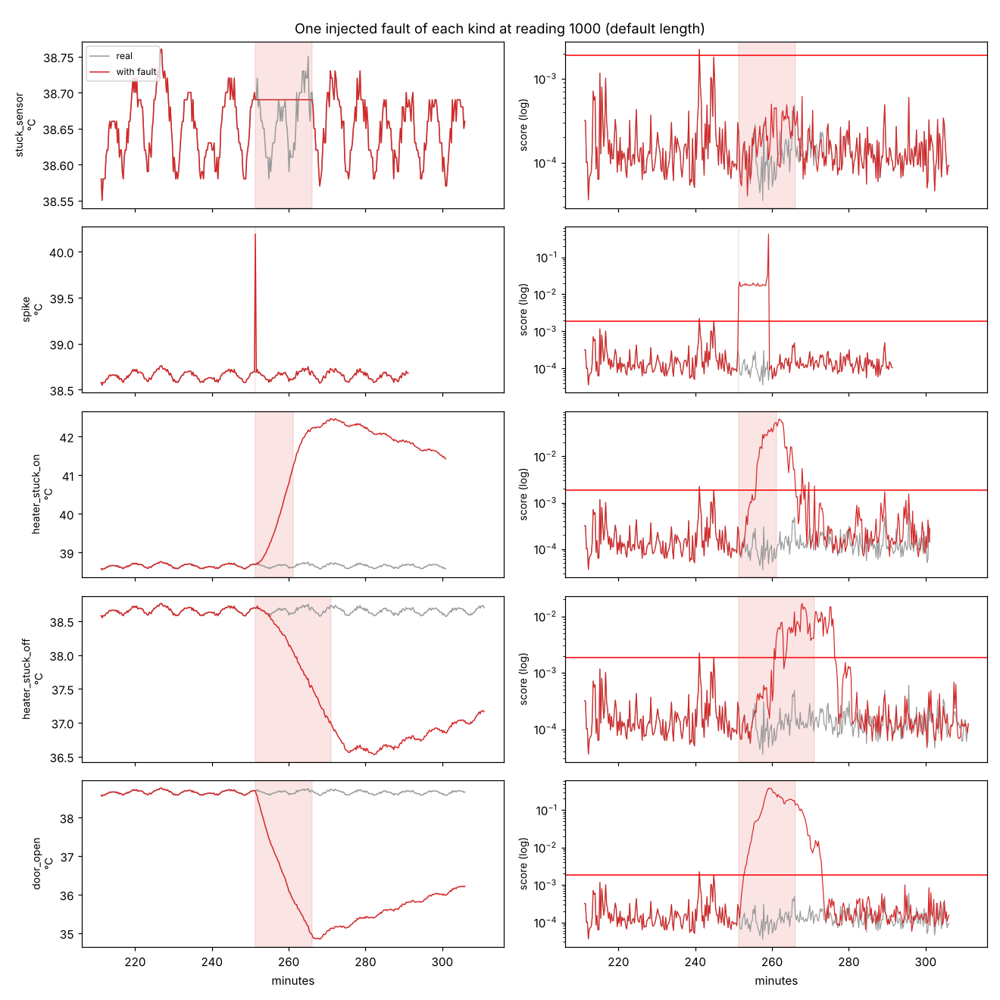

# tinyml-esp32-anomaly

A tiny autoencoder (1 699 weights, 6 560-byte int8 TensorFlow Lite model) that scores 8-minute
temperature windows from a queen-bee incubator and flags the ones it cannot reconstruct. It is
trained on one real day of telemetry from the `incubator-telemetry-analysis` repo, exported for
TensorFlow Lite Micro, and shipped with an ESP32 sketch plus a host-side test that replays
recorded windows through the same C code the board runs. Faults are injected into the real
trace to measure what it detects; the limits of one device, one day are stated below.

```
 data/hive-1C5A00_history_2026-10-03.json  (1 367 real readings, 15 s, temp + heater state)
          │
          ▼  src/tinyml/windows.py: 32-reading windows -> 63 features
   ┌──────────────┐   train on 534 "normal" windows    ┌──────────────────────────┐
   │ tinyml.train │ ───────────────────────────────▶   │ model/anomaly_ae_int8.tflite │
   └──────────────┘   63 → 16 → 4 → 16 → 31 (tanh)      └──────────────────────────┘
          │                                                     │
          ▼ tinyml.evaluate: threshold on 461 validation        ▼ tinyml.export_c
            windows, 100 injected faults, figures/        lib/anomaly_core/model_data.cc,
                                                           model_params.h, test_vectors.h
                                                                │
                            ┌───────────────────────────────────┴──────────────────┐
                            ▼                                                      ▼
              test/test_native (g++ or pio native):                 src/ (ESP32, TFLM):
              Window.cpp + float reference kernel,                  Window.cpp + int8 interpreter,
              245 recorded windows vs interpreter scores            self-check on the same windows,
                                                                    score > threshold -> LED + ALARM
```

## What the model sees

A window is the last 32 readings (8 min). Its 63 inputs are the 31 temperature differences
from the window's first reading (divided by 2 °C) and the 32 heater on/off states. The
autoencoder reconstructs only the 31 temperature values; the heater pattern is context. The
score is the mean squared reconstruction error. Differences rather than absolute temperatures
make a window at 30 °C and one at 38.8 °C look alike when the chamber behaves alike.

Train/validation split: 30-minute blocks of the day alternate between the two sets and windows
that straddle a block boundary are dropped, so no reading is shared (534 train, 461 validation,
341 dropped). The threshold is the 99.5th percentile of int8 scores on validation windows.

## Run it

Host checks need Python 3.11, NumPy, pytest, ruff and g++. The full pipeline also needs
TensorFlow (2.21 was used) and matplotlib. Flashing needs PlatformIO and an ESP32.

```bash
pip install -r requirements-dev.txt
make check                      # ruff + 11 pytest + the C host test (307 checks)
make all                        # retrain, re-evaluate, regenerate lib/anomaly_core, re-check
pio test -e native              # the same C test through PlatformIO
pio run -e esp32dev -t upload && pio device monitor
```

`make all` reproduces the committed model, `figures/` and C sources byte-for-byte on the
machine it was built on (seeded; other machines may differ in the last digits).

## Results

All numbers below are produced by the code in this repo and stored in `model/train_report.json`,
`figures/results.json` and `model/export_report.json`.

**Clean day** (1 336 windows, no fault): median score 0.00011, threshold 0.00188, 3 windows
flagged in 5.7 h (minutes 117, 119 and 241, one window each). All three are in validation
blocks, which is what the 99.5 % rule implies; the training blocks have none.

**Injected faults**, 20 random positions each (same kinds and durations as repo #1; the three
physical ones are synthesised with its fitted second-order thermal model, `a` = 0.59 °C/min,
`τh` = 4.9 min, `b` = 0.0111 /min, and added to the measured trace):

| fault | duration | detected | chance floor | median delay | peak score / threshold |
|---|---|---|---|---|---|
| spike (+1.5 °C, one reading) | 15 s | 20/20 | 0/20 | 0 min | 12 |
| door open (loss ×4) | 15 min | 20/20 | 2/20 | 1.8 min | 73 |
| heater stuck on | 10 min | 19/20 | 2/20 | 4.3 min | 34 |
| heater stuck off | 20 min | 14/20 | 2/20 | 9.3 min | 6.2 |
| stuck sensor (flat reading) | 15 min | 9/20 | 2/20 | 11 min | 0.73 |

"Detected" means at least one flagged window ends between 1 min before and 5 min after the
fault; "chance floor" is the same test on the clean trace (the day's own three false alarms
landing in that interval). False alarms *before* a fault average 1.65 episodes per trial, which
is exactly the clean day's three single windows: injecting a fault adds none. Windows flagged
*after* the 5-minute settle margin (1.5 to 3.9 episodes per trial) are mostly the chamber still
recovering: with a 90-minute time constant a 10-minute heater fault leaves the chamber 5 °C hot,
and the hour of faster-than-normal cooling that follows looks abnormal too (figure 02).

The stuck sensor is the honest failure: a flat temperature with the heater off looks like the
real steady state, and its median peak score stays under the threshold. Repo #1's model-drift
detector had the same difficulty (0.6 detection rate). The heater-stuck-off case is slow
because cooling at 0.2 °C/min is only a little faster than the normal post-pulse decay.




**Float vs int8.** On validation windows the int8 model's score differs from the float
model's by a median 0.00003 (max 0.0012). On the clean day four of 1 336 verdicts flip: three
sit within 11 % of the threshold on both sides, the fourth (minute 241) scores 0.54× the
threshold in float and 1.19× in int8 and is one of the day's three false alarms. The first export calibrated the int8 ranges on training windows
only, and the output could then not represent the one fast cool-down of the day (after the
first overshoot, in a validation block): clipping turned a float score of 0.00014 into 0.0030,
a false alarm. The ranges are now calibrated on all clean windows; weights are unchanged.

**Host test** (`make check`), the part a reviewer can run without a board:

```
  reference_kernel_matches_interpreter_on_recorded_windows
note: 245 windows, 145 flagged, worst |ref - interpreter| = 53 % of tolerance
  clean_segments_stay_quiet_and_faults_fire
note: clean_cooldown_val        33 windows,  0 flagged
note: clean_steady_38_8_val     33 windows,  0 flagged
note: spike                     33 windows, 24 flagged
note: heater_stuck_on           65 windows, 45 flagged
note: door_open                 81 windows, 76 flagged
307 checks passed, 0 failed
```

The reference kernel runs the dequantised weights in float with the int8 input/output clipping
emulated; its tolerance against the TFLite interpreter is measured by `export_c.py` (absolute
0.0017 near the threshold, 38 % relative on fault windows where int8 rounding inside saturated
tanh layers matters more). The sketch's boot self-check applies the same test on the board.

## Footprint on the ESP32

| item | value | how known |
|---|---|---|
| model file | 6 560 bytes (1 699 int8 weights, 4 FULLY_CONNECTED + 3 TANH) | measured, `model/export_report.json` |
| activations | 166 bytes of int8 tensors; `TENSOR_ARENA_BYTES` set to 8 192 incl. TFLM bookkeeping | tensor shapes; the sketch prints `arena used` |
| inference | 1 632 multiply-accumulates: well under 1 ms at 240 MHz | **estimate**, the sketch prints the measured µs |
| firmware size | see the `firmware-build` CI job | not flashed in this repo |

The firmware was compiled by CI, not flashed or timed on a board: the arena and timing lines
above are what to read off the serial monitor first.

## Limitations

- One device, one day (5.7 h, door shut, ambient 27–28 °C). Regimes seen once (the first
  overshoot, the first pulses at 38.8 °C) are the ones the model knows least; a second day
  would change the threshold.
- The physical faults are synthetic deviations from a fitted model added to real noise, not
  recorded faults; the stuck sensor and the spike are the only ones that need no model.
- The model needs the heater state, so it belongs inside the controller firmware, not on a
  separate listener.
- Reading dropouts are not scored (a sampling watchdog is the right tool); the window is
  index-based and ignores the two 30–74 s gaps in the day.

## Next steps

- Flash, read `arena used` and the inference time, and shrink `TENSOR_ARENA_BYTES`.
- Add humidity as a second reconstructed channel once a second day of data exists.
- Score the first reading after a gap with a `dt` feature instead of ignoring timing.
